# GabeCubeAura

GabeCubeAura is a Decky Loader plugin for the Steam Machine's light bar and
optional JSAUX Pixel Matrix Faceplate. Configure game artwork colours,
controller battery indicators, CPU/GPU meters, weather, custom effects and
audio or screen synchronisation.

Created and maintained by **Alyenax**.

If GabeCubeAura makes your Steam Machine a little better, you can support its
development on Ko-fi. Thank you! ❤️

**Documentation for GabeCubeAura 1.5.0.** Its plugin package has not been released yet. The latest public download remains **1.4.0**; the Faceplate features below describe 1.5.0.

[Download current public version · 1.4.0](https://github.com/Alyenax/GabeCubeAura/releases/download/v1.4.0/GabeCubeAura-v1.4.0.zip)
· [1.5.0 overview](https://github.com/Alyenax/GabeCubeAura/wiki/Release-1.5.0)
· [User guide](https://github.com/Alyenax/GabeCubeAura/wiki)
· [Changelog](https://github.com/Alyenax/GabeCubeAura/blob/main/CHANGELOG.md)
· [What's new in 1.5.0](https://github.com/Alyenax/GabeCubeAura/wiki/Release-1.5.0)

## Artwork

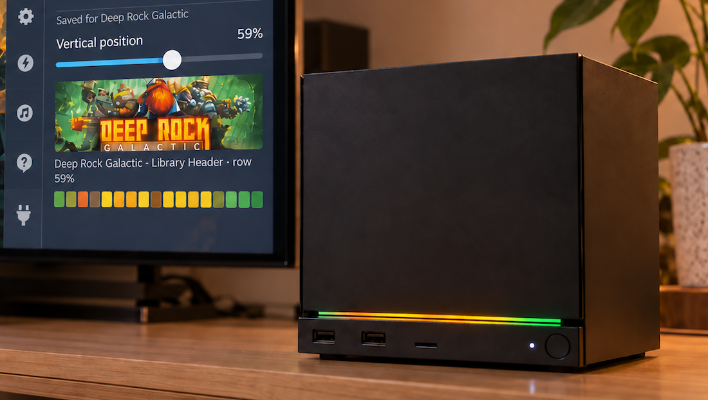

Sample your current game's artwork to set the 17 light-bar colours. Choose its Hero,
Header or Capsule image, then let GabeCubeAura find a suitable row or select
one yourself. Your choice is remembered for each game.

Local Steam artwork comes first, including your custom images and non-Steam
shortcuts. With a Faceplate, you can also prepare static or animated artwork
for its 64 × 54 matrix and reuse it when the game starts.

## Light bar, without a Faceplate

The light bar works on its own. Light events combine Steam notifications, achievements, screenshots and recording signals.

| Performance | Controllers | Weather | Light events |
| :---: | :---: | :---: | :---: |
| 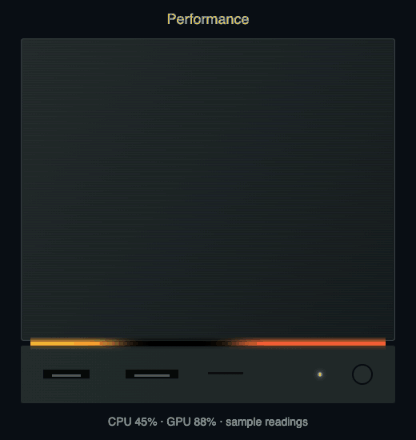 | 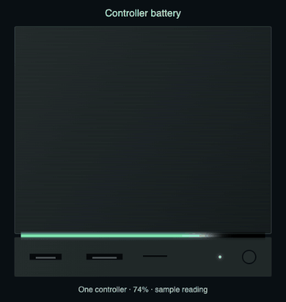 | 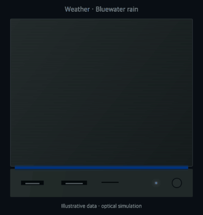 | 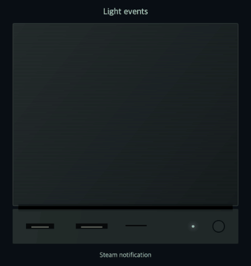 |
| CPU/GPU load and temperatures. | Battery levels and charging. | Animated weather for your city. | Steam alerts Captures · recording. |

For a more personal setup, match the light bar to the picture or audio, choose your own effects, or keep track of remaining time. The countdown works with a personal timer or a supported Steam Families limit when available.

| Screen Sync | Audio Sync | Customization+ | Countdown |
| :---: | :---: | :---: | :---: |
| 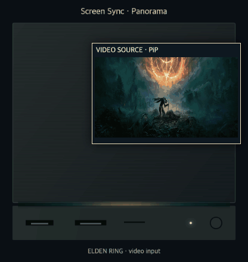 | 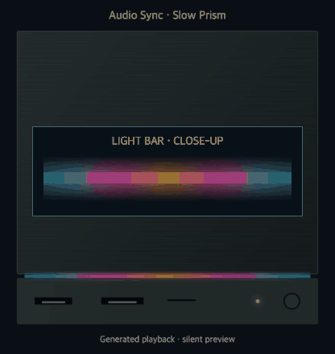 | 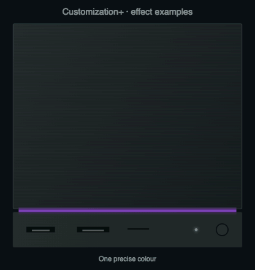 | 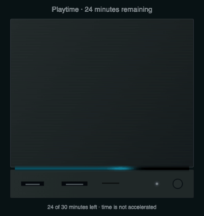 |
| Picture-in-picture colour matching. | Slow Prism reacts to playback. | Your colours and effects. | Personal timer or Steam Families. |

Choose different displays for Home, games and individual titles. One global
light-bar brightness setting applies across those choices, with optional
sunset dimming for a city you select.

## With a JSAUX Pixel Matrix Faceplate

The optional Faceplate adds a second display. Its content and brightness can
be set separately from the light bar.

<table>
<tr>
<th align="center" width="33%">Animated artwork</th>
<th align="center" width="33%">Dashboard · The Witcher 3</th>
<th align="center" width="33%">Steam Players City</th>
</tr>
<tr>
<td align="center" valign="top">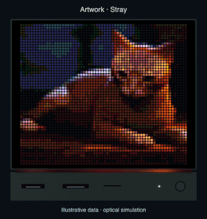</td>
<td align="center" valign="top">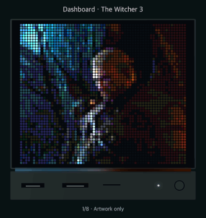</td>
<td align="center" valign="top">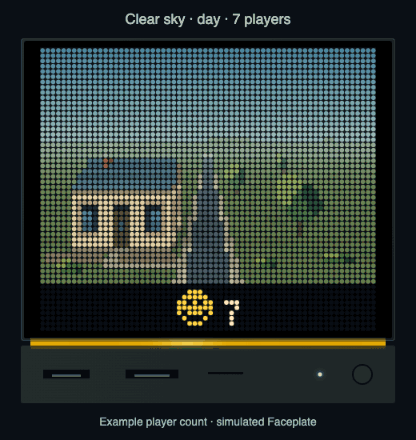</td>
</tr>
<tr>
<td align="center" valign="top">Static or animated artwork saved for each game.</td>
<td align="center" valign="top">Eight layouts: game data, weather and countdown.</td>
<td align="center" valign="top">From village to city, with day, night and weather.</td>
</tr>
<tr>
<th align="center" width="33%">Weather</th>
<th align="center" width="33%">Personal timer</th>
<th align="center" width="33%">TV + Faceplate · DAS</th>
</tr>
<tr>
<td align="center" valign="top">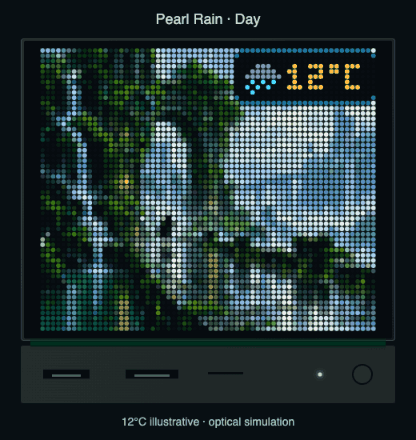</td>
<td align="center" valign="top">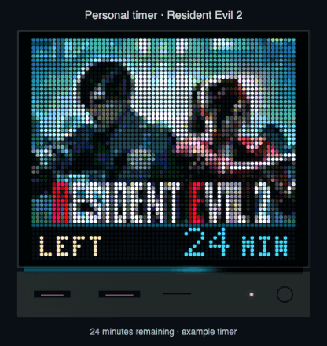</td>
<td align="center" valign="top">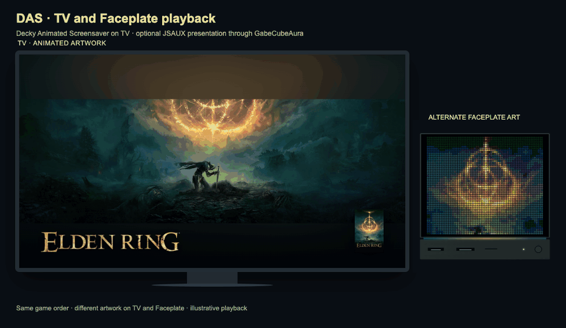</td>
</tr>
<tr>
<td align="center" valign="top">Your city’s weather on both displays.</td>
<td align="center" valign="top">A visible countdown over game artwork.</td>
<td align="center" valign="top">Different artwork on each display. Requires the separate DAS plugin.</td>
</tr>
</table>

Choose a weather scene, Artwork Dashboard or other supported display for
Home and games. Dashboard rows can show controller batteries,
session time, recorded playtime or achievement progress when data is available.
Steam Players City turns the running game's player count into an animated city.

**Decky Vocal Assistant (DVA)** can add optional voice-assistant visuals through
GCA, while **Decky Animated Screensaver (DAS)** can share prepared screensaver
collections with the Faceplate. Both are separate plugins; see the
[integration guide](https://github.com/Alyenax/GabeCubeAura/wiki/Integrations).

*The animated device previews are software illustrations with example readings.*

## Compatibility

- Designed for the official Steam Machine's **17-pixel light bar** and
  **Decky Loader on SteamOS**.
- Faceplate features require the **JSAUX Pixel Matrix Faceplate**. It is optional.
- CPU/GPU sensors and controller batteries depend on the hardware and data
  exposed by SteamOS. Missing readings stay unknown.
- Screen Sync requires a working Gamescope PipeWire capture source and its
  system tools. GabeCubeAura reports missing components.
- Steam callbacks may change between Steam updates. Compatibility with every
  controller and connection type has not been verified.

## Install and get started

The download above is **1.4.0**, which supports the native light bar. The 1.5.0 package with Faceplate support will follow. Keep the downloaded ZIP zipped for Decky installation.

1. Install [Decky Loader](https://decky.xyz/) on your Steam Machine.
2. Download the plugin ZIP without extracting it.
3. Open **Decky → Settings → Developer → Install Plugin from ZIP File** and
   choose the downloaded file. Enable Developer mode if that section is hidden.
4. Open GabeCubeAura and complete guided setup: choose an experience, set
   brightness, review your choices and confirm.

## Guides and support

Start with the [user guide](https://github.com/Alyenax/GabeCubeAura/wiki) for installation, first setup,
light-bar displays, Faceplate artwork, dashboards and optional integrations.
It also covers update choices, backups, reset, privacy and troubleshooting.

Report a problem through [GitHub Issues](https://github.com/Alyenax/GabeCubeAura/issues).
Include your plugin version, SteamOS version, connected hardware and the steps
that reproduce it. Never post API keys or access tokens.

For what has changed, read the [changelog](https://github.com/Alyenax/GabeCubeAura/blob/main/CHANGELOG.md). If you would like to
support the next steps, [buy me a coffee on Ko-fi](https://ko-fi.com/alyenax).

## Privacy and independence

Artwork sampling and screen processing run locally. Optional weather uses
Open-Meteo and a city you select; online Faceplate artwork uses your own
SteamGridDB API key. See the guide for optional integrations and network requests.

GabeCubeAura is an independent community project by Alyenax. It is **not
affiliated with, endorsed by or sponsored by Valve or JSAUX**. Steam and Steam
Machine are Valve trademarks; JSAUX and the associated product names belong
to their respective owners. Game artwork belongs to its creators and rights
holders; see the [preview credits](https://github.com/Alyenax/GabeCubeAura/blob/main/docs/media/public/CREDITS.md).

The GCA code, including the Faceplate engine and UI, uses GPL-3.0-only. Separately identified original Faceplate images and animations owned by Alyenax use CC BY-NC-SA 4.0; third-party elements and user imports retain their own rights. Composite demonstration GIFs are not licensed as a whole by that notice. See [Licensing and reuse](https://github.com/Alyenax/GabeCubeAura/wiki/Licensing) and the [media notice](https://github.com/Alyenax/GabeCubeAura/blob/main/docs/media/public/LICENSING.md).

[Faceplate artwork inventory](https://github.com/Alyenax/GabeCubeAura/wiki/Faceplate-Artwork-Inventory) · [Complete file list and hashes](https://github.com/Alyenax/GabeCubeAura/blob/main/docs/media/public/faceplate-assets.json).
