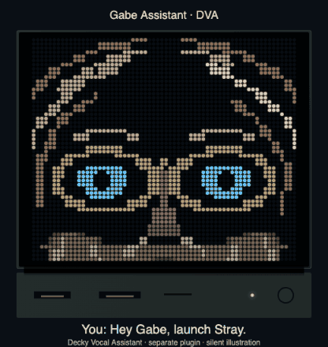
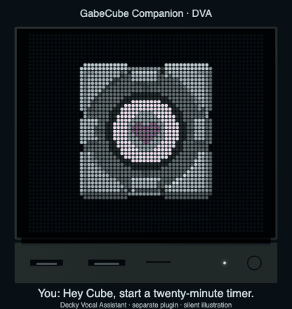
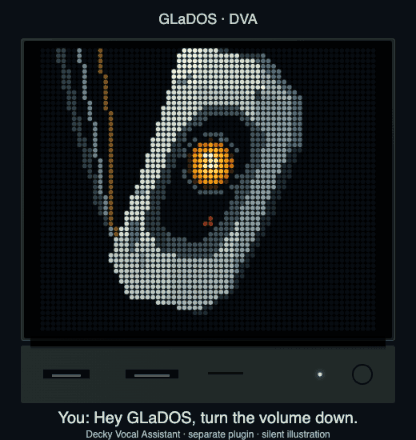
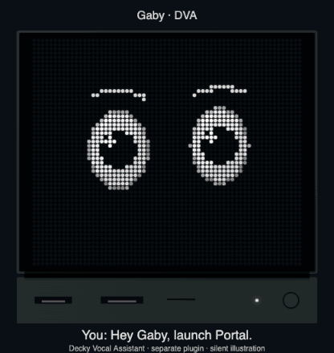

# Decky Vocal Assistant

> Companion plugin · installed and configured separately from GabeCubeAura.

DVA owns the microphone, activation, voice commands and character responses. GabeCubeAura provides the optional light-bar and JSAUX Faceplate presentation. These assistants are not built into GCA. Voice control does not require a Faceplate.

Choose a character in DVA. Each has its own appearance and associated voice. These four examples use the current character catalogue and different everyday scenarios.

| Gabe Assistant · starting a game | GabeCube Companion · a personal timer |
| :---: | :---: |
|  |  |

| GLaDOS · volume control | Gaby · clarifying a game title |
| :---: | :---: |
|  |  |

The GIFs are silent, scripted illustrations using DVA's character animations. The light-bar mouth follows a generated speech envelope; it is not a recording of the displayed dialogue. No microphone listens and no game, timer or volume action runs in these previews.

Configure your microphone, activation method, language and character in DVA. When a visual response ends, GCA restores the selected Home or game display. Opening GCA does not enable microphone listening.

Created and maintained by **Alyenax**. [Support my work on Ko-fi](https://ko-fi.com/alyenax). DVA and GCA are independent community projects, unaffiliated with Valve or JSAUX. Character designs and trademarks belong to their respective owners. See the [preview credits](https://github.com/Alyenax/GabeCubeAura/blob/main/docs/media/public/CREDITS.md).
